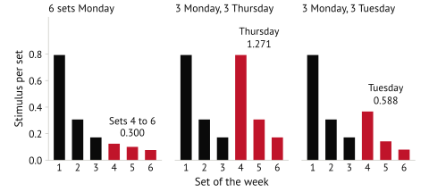

## The gap

Training apps log what you lifted, and you learn whether a program worked two months later.
AlgoSplit predicts a program's weekly outcome across 29 muscle regions before you run it.

## In use

Take six rear-delt sets a week. Net is stimulus minus atrophy:

| Schedule             | Stimulus | Atrophy |    Net |
| -------------------- | -------: | ------: | -----: |
| 6 sets Monday        |    1.572 |   1.610 | −0.038 |
| 3 Monday, 3 Thursday |    2.543 |   0.966 |  1.577 |
| 3 Monday, 3 Tuesday  |    1.859 |   1.288 |  0.571 |

Each set in a session adds less than the set before it:

Sets 4 to 6 add 0.300 at the end of a Monday session and 1.271 as a separate Thursday session.
Atrophy builds through the idle hours after each 48-hour window:

Across the first hundred user programs, average net weekly stimulus rose 35 percent.

## Shipped

Web and iOS ship from one codebase. I ported the analysis kernel from Python to Rust, and
uncached p95 fell from 31.9 ms to 3.85 ms.
