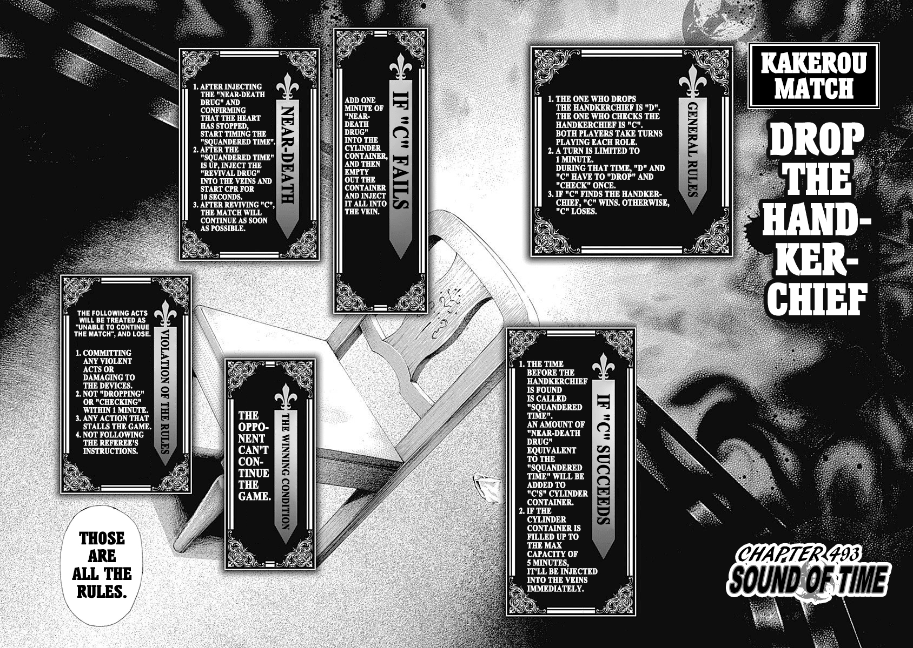
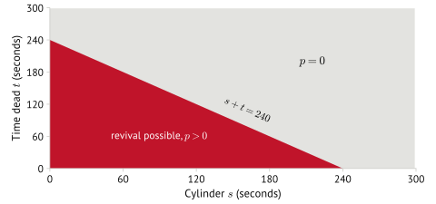
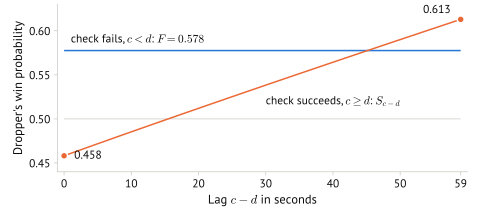

## The rules

The commentary and the round-by-round numbers disagree in a few places. I logged each rule
against its evidence and followed the arithmetic where they conflict.

## The game

Each round, the Dropper picks a second $d$ and the Checker picks a second $c$, both from 1 to 60
and at the same time. The check fails when $c<d$. The Checker then dies and may revive, with
lower odds for more poison and more time dead:

The manga gives no revival rate, so I chose one. The 0.5449 result depends on that choice.

## The obstacle

Any fixed second gives the opponent something to exploit, so both players mix over all 60:

Written out directly, the game has about 5.27 billion reachable states. A full solve would take
about five years on one core.

## The collapse

Once a player can no longer revive, their time dead has no further use. I proved that merging
those states keeps the game value:

$$
\varphi(s,t)=\begin{cases}
(s,\,t), & p(s,t)>0 \\[2pt]
(s,\,\bot), & p(s,t)=0
\end{cases}
$$

A potential function sorts the 289,374,121 classes into 1,201 layers, and one backward pass
solves them.

## Checking the answer

Each stored value carries a certificate that it sits within one part in a million of
equilibrium. The round matrix has only 61 distinct entries, so a certificate is cheap:

I wrote the first sweep in Rust and in Python, and the two agreed byte for byte.

## Result

The first Dropper wins with probability 0.5449:

Going first is worth about 16 seconds of poison.

## The leap second

The manga's match crosses a leap second at 8:59:60. Baku plans to drop in that 61st second, which
the Checker cannot match. The minute alone moves Hal's chance between 21 and 70 percent:

From the opening, the leap second cuts Hal's win probability from 0.5449 to 0.5186.
